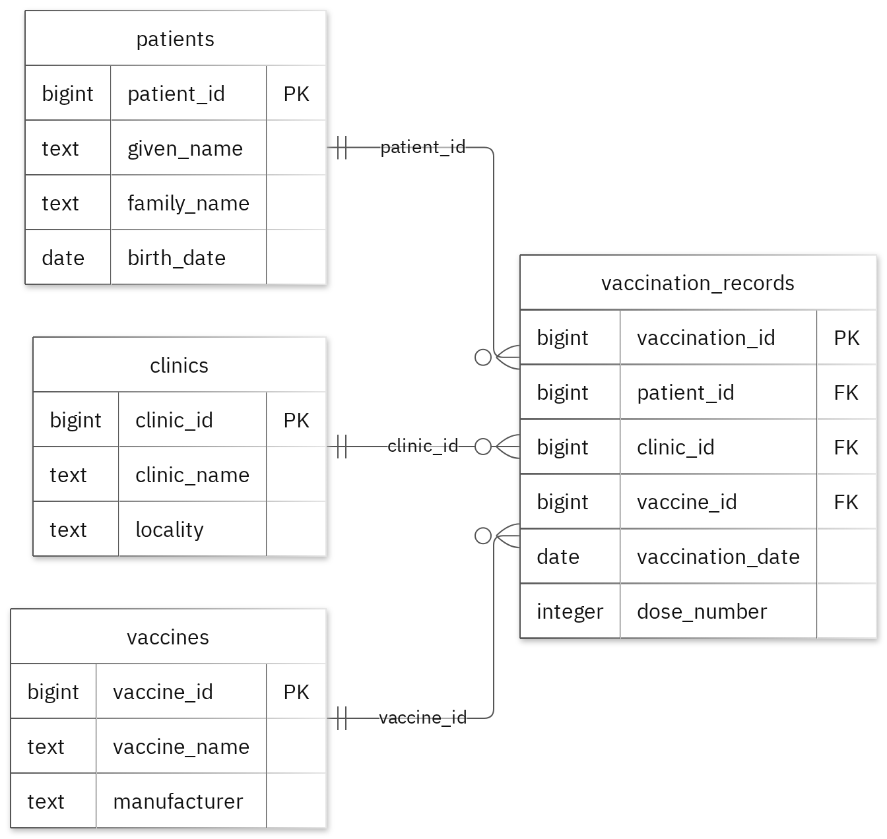

# MIT 8103 Advanced Database Systems

**Public Health Vaccination Programme** · Olusola Lawale · Student ID 301932267

## Case study

My case study is the Public Health Vaccination Programme, a fictional system for recording vaccinations and reviewing programme activity. Its users are clinic staff recording vaccinations and programme analysts reviewing the records. Separate tables named patients, clinics, vaccines and vaccination_records store patient details, clinic locations, vaccine products, vaccination dates and dose numbers. The system supports recording a vaccination with its patient, clinic and vaccine; reviewing the linked details; and summarising records by clinic and vaccine.

## Portfolio 1: Database Design and Modelling

I organised the relational design into 4 tables. Primary keys identify records, foreign keys preserve the links, and checks enforce the stated business rules. A vaccination record's dose_number must be greater than zero. The normalisation examples show the sample data at 1NF, 2NF and 3NF. All 10 deliberately invalid inserts were rejected without changing the valid sample rows.

Figure 1. Tables, keys and relationships. PK: primary key; FK: foreign key; UK: unique value.

<!-- PAGE BREAK -->

## Portfolio 2: Query Processing and Optimisation

I ran four SQL queries against the sample records. The join returned 1 row and included Ari with North Fictional Clinic. For the index comparison, I used 20,000 separate performance rows. The median lookup time changed from 2.138 ms to 0.182 ms. Both phases returned the same records. The measured plan used the new index. These timings apply to this lookup and environment.

## Portfolio 3: Transactions and Concurrency

I used a temporary counter on vaccination_records to test COMMIT, ROLLBACK and READ COMMITTED isolation. The uncommitted update remained hidden from the other session, and ROLLBACK restored the earlier committed value. Without locking, two increments left the counter at 2. With SELECT FOR UPDATE, Session B waited for Session A and the final value was 3. The helper is confined to this exercise; the case's original business fields stay unchanged.

## Portfolio 4: NoSQL and Advanced Data Models

I used vaccination_events for the case's event documents. MongoDB inserted 2 sample events and returned the expected results for 4 queries. Validation rejected an invalid date type and a duplicate event ID. Embedded snapshots keep related details with an event, while the details field can differ by event type. These are fictional events; PostgreSQL continues to enforce its relational rules.

## Repository and evidence

https://github.com/OlusolaLawale50/Lawale_Olusola_301932267

The portfolio folders contain the SQL and JavaScript, explanations, query plans, result tables and screenshots.

<!-- PAGE BREAK -->

## Portfolio 5: Distributed and Cloud Database Exercise

I proposed three MongoDB replica members across separate failure zones. The discussion covers primary elections, majority acknowledgement, secondary lag and sharding trade-offs for vaccination_events. Replication supports availability, while backups address recovery. PostgreSQL needs its own availability plan. This is the permitted discussion option; no live replica set or failover test was deployed.

## Individual reflection

My main design lesson is that separating patients, clinics, vaccines and vaccination records reduces repeated details, but the relationships still need enforceable rules. The ten recorded constraint rejections illustrate how foreign keys, required values, positive dose numbers and uniqueness protect the model.

For queries, I take from Portfolio 2 that a correct result alone does not explain efficiency. The saved comparison reports median times of 2.138 ms before indexing and 0.182 ms afterwards on 20,000 separate performance rows. The plan changes from a sequential scan to bitmap scans, but still includes a sort. I should therefore explain the actual plan and its limits rather than assume an index removes every cost.

The concurrency example makes a different risk clear: two sessions can each perform a valid update yet lose an increment when both calculate from the same earlier value. The recorded counter finishes at 2 without locking and 3 with SELECT FOR UPDATE. My lesson is to protect the read-and-update sequence when correctness depends on shared state.

The MongoDB snapshots also show a trade-off: an event is convenient to read, but later relational changes do not automatically refresh its copied details. My evidence has limits: the relational sample is small, the generator produced the recorded exercise outputs and images, and Portfolio 5 is a proposed design without a live failover test.

With more time, I would prioritise a live replica-set failure-and-recovery exercise to test the availability discussion against observed behaviour.

## AI-use declaration

- **Tools used:** GitHub Copilot, the portfolio generator and Codex. Copilot and the generator are disclosed in the original submission; Codex assisted with this documentation revision.
- **Uses:** Copilot and the generator helped prepare the database model, scripts and explanations. The generator ran the PostgreSQL and MongoDB exercises, checked their outputs and captured the result images. Codex helped polish the README and final summary, drafted the reflection from recorded results, and prepared the LMS packaging files.
- **Review and verification:** The generator's checks and saved results are recorded in the portfolio documentation. For this revision, Codex compared the summary with the saved design, portfolio explanations and results; no new database runs or evidence images were produced. I remain responsible for checking and explaining the submitted work. My personal review of this revision, including the AI-drafted reflection, is pending; the PDF will be rebuilt after I review and approve the wording.

## References

- [PostgreSQL: constraints](https://www.postgresql.org/docs/17/ddl-constraints.html)
- [PostgreSQL: EXPLAIN](https://www.postgresql.org/docs/17/using-explain.html)
- [PostgreSQL: isolation](https://www.postgresql.org/docs/17/transaction-iso.html)
- [PostgreSQL: row locks](https://www.postgresql.org/docs/17/explicit-locking.html)
- [MongoDB: data modelling](https://www.mongodb.com/docs/manual/data-modeling/)
- [MongoDB: replication](https://www.mongodb.com/docs/manual/replication/)
- [MongoDB: sharding](https://www.mongodb.com/docs/manual/sharding/)
- [Mermaid: ER diagrams](https://mermaid.js.org/syntax/entityRelationshipDiagram.html)

